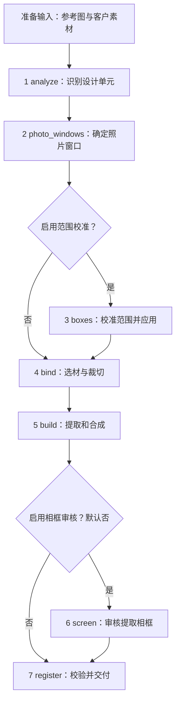

# 从输入到交付

汇报与逐步讲解可打开 [VLM 工作流图谱](../reports/workflow-atlas/index.html)。报告内嵌图片、样式和脚本，单独复制 `index.html` 即可离线查看；它是源码与已有分阶段记录的静态快照。`workflow-overview.svg` / `.png` 为独立总览图，`workflow-data.json` 为结构化内容。

在本机工程根目录运行 `python -B reports/workflow-atlas/build_atlas.py` 可从源码和相邻 `collage-recreate-v9-output/checks/` 中的已有案例重新生成 HTML、SVG、JSON，不调用模型。PNG 可在页面导出；浏览器验证脚本 `verify_atlas.py` 也会生成 PNG，依赖本机 Chrome/Edge 与 `websocket-client`。迁移后只查看报告无需这些依赖；重新生成则需要保留来源案例。

工作台的主线按产物分成五步：准备素材 → 分析素材（`structure.json`、`analysis-boxes.png`）→ 判断窗口蒙版（`photo-windows.png`）→ 素材绑定与提取（`bindings.json`、360 图层）→ 首版成图。校验不作为前端节点。

UI 映射集中在 `workbench/server/workflow_view.py`。工作流把简要状态同步到任务目录的 `workflow-progress.json`；素材提取完成、渲染开始由 `materials_started` 事件区分。仅有部分产物的案例标为“已有产物”，不推定后续步骤完成。底层执行阶段和文件校验继续按下文运行。

先读 [pipeline.py](../collage/workflow/pipeline.py) 的 `run_stages()`。它只负责执行顺序，阶段内部的判断、校验和文件写入位于 `stages/`。



## 每个阶段的边界

新分析必须包含恰好一个 `kind=background`，且位于 `layer_order` 第一项。`background_type=photo` 表示客户素材铺底，`reference_clean` 表示清版后保留的固定底图，`solid_color` 表示带明确颜色的本地底色。多张独立照片拼满画布且无可见底图时，使用透明底色占位，照片范围保持独立。背景 bbox 由程序固定为全画布、旋转归零，不再按层序猜测哪张普通照片应该铺满。

分析先依据显示边界、内容连续性和遮挡关系确定独立照片与固定设计单元，再选择背景来源。唯一背景不改变各单元的替换范围。`solid_color` 仅执行一个均匀颜色填充；需要保留空间变化的颜色、图案或材质时，应选择 `reference_clean` 或将独立设计单元单列，不能仅写进描述而继续使用纯色路线。

客户素材背景保留 `kind=background`，和普通 photo 一起进入窗口判断、binding、静态及 Live 渲染；固定背景不进入照片选材。窗口阶段不得将客户素材背景抠图、缩小、旋转或增加固定窗口/渐隐。出框前景可用 `linked_to` 指向客户素材背景，共用素材和变换。缺失、重复背景或来源不明进入结构重试，不能通过仅修改个别字段的修复绕过。旧产物不会自动重新分类；需要用新分析重新运行来修正已有语义错误。

| 阶段与实现 | 输入 | 责任与输出 | 结构化 VLM |
| --- | --- | --- | --- |
| 准备输入：[prepare.py](../engine/scripts/prepare.py) | 参考图、客户图片/视频、客户说明 | 复制和校验输入，生成 `input.json`、`prepared/reference.png`、`prepared/catalog.json` 与联系表 | 无 |
| 1 [analyze.py](../collage/workflow/stages/analyze.py) | 参考图 | 识别对象、水平外接框、归属、层级和关联；照片内容与可见效果写入 description，不输出 mode 或 effects。保存 `structure.json`，编译 `analysis.json` 和 `text-units.json` | 首次 1 次；有错误时最多追加 1 次局部修复或整体重试 |
| 2 [photo_windows.py](../collage/workflow/stages/photo_windows.py) | photo/frame 及 background_type=photo 的背景、参考图和照片裁片 | 确定普通照片的制作框、角度、主体处理、窗口和渐变；客户素材背景固定全画布并保留摄影环境。保存 v3 `photo-windows.json` | 有客户照片或客户素材背景时调用；不合规输出最多纠正 1 次 |
| 3 [boxes.py](../collage/workflow/stages/boxes.py) | 已有对象和带原框标记的局部裁片 | 只校准范围，保持身份、归属、层级和效果。保存校准决策和映射，本地 `boxes_apply` 应用 | 可选，默认关闭；全部目标合在一次请求中 |
| 4 [bind.py](../collage/workflow/stages/bind.py) | `structure.json` 的 photo 描述和关联、`analysis.json` 中窗口阶段确认的制作框与角度，加窗口结果推导的 `requires_segmentable_subject`；客户说明、素材及联系表 | 程序整理精简的 `workflow/binding-input.json`，按旋转前制作框计算实际宽高比，一次完成观察、选材和裁切，保存 `bindings.json`。独立绑定没有 analysis 时沿用结构清单几何 | 有照片槽时 1 次；缺少窗口计划或绑定失败时停止，禁止自动换一套绑定 |
| 5 [build.py](../collage/workflow/stages/build.py) | 分析、窗口、绑定 | 提取固定素材，使用客户像素渲染照片并合成；输出 `scene.json`、`final.png`、`result.json` | 无；素材提取可调用独立图像服务 |
| 6 [screen.py](../collage/workflow/stages/screen.py) | 成图、相框提取候选与检查表 | 仅检查相框内是否残留参考照片。`screen_apply` 在本地应用决策 | 可选，默认关闭；开启且有可审核相框时调用 |
| 7 [deliver.py](../collage/workflow/stages/deliver.py) | 成图、资源记录和告警 | 校验文件与客户照片来源，登记交付状态和 `review.json` | 无；不声称已经完成整图视觉审核 |

`text-units.json` 是本地引擎使用的文字记录，由分析清单编译生成；首次 VLM 不重复填写这份台账。

窗口阶段的矩形/圆角矩形可输出 `placement.type=rectangle_corners` 和照片内口四角；归一化角点先按参考图宽高分别转换为像素，再由 `window_geometry.py` 拟合旋转矩形，得到制作框及角度。心形、星形、椭圆、圆形、多边形及无固定窗口继续使用 `box_rotation`；历史 bbox/rotation 响应仍可回放。后续 analysis、绑定及渲染只接收像素制作框和角度，不新增 analysis 字段或 VLM 阶段。

角点必须构成非退化凸四边形；拟合偏差超过短边 5% 时提示复核，超过 30% 时拒绝。这些阈值检查几何自洽，不证明角点位于真实边界。原角点与拟合矩形保存在窗口阶段证据中，`previews/window-geometry.png` 用红色显示原角点、青色显示拟合结果。替代相框继续围绕最终照片内口扩边并共享旋转；正常提取的相框保留原像素。

独立 text 在首次分析中保留参考图的逐行内容，JSON 字符串用 `\n` 表示真实换行，同时给出 color、font、align、bold、italic，不分析字号和行间距。渲染按 bbox 的宽高，以字体标准单倍行距（字体 ascent + descent）为下限选择能容纳整段文字的最大字号；多行文字将框内剩余高度均匀分到行间，避免只在上下留白、行间仍拥挤。单行垂直居中，空行保留，不把段落合成单行。导出尺寸变化后按实际文字框重新适配。资源记录保存实际字号、行数、行距倍率和基线距离，便于检查排版；引擎仍兼容既有场景或手动编辑中的显式字号、行距，显式行距不自动拉开。

`screen` 开关通过工作流 CLI、单任务/批跑接口或 `batch_run.py` 配置，默认 `false`。关闭时 `screen` 和 `screen_apply` 均跳过，继续交付；开启后仍只审核提取相框。开关随任务保存，续跑不能改变。

analysis 输出 `objects` 和 `layer_order`；后者用对象 ID 明确从底到顶的顺序，objects 的列举顺序不决定层级。程序只整理图层 ID：未知 ID 删除，重复 ID 保留第一次（最底层）出现；缺失 ID 按 objects 顺序逐个补入，放在清单中前一个对象之后，清单第一项缺失时补到最底层。已有合法 ID 的相对顺序不变；整个 layer_order 缺失时使用 objects 的 ID 顺序。这些整理均在校验前本地完成，不额外请求 VLM。

程序不根据 `photo_id`、`linked_to` 推导或修正照片、相框和出框前景的先后。关联存在性、对象 ID 唯一性等结构校验继续执行。整理后的 layer_order 保存到 structure.json、analysis.json，并沿用到窗口与渲染步骤；相框审核的 keep/backing 决策也不移动相框或照片。原始响应保存在 `response-*.json`，接收结果保存在 `accepted.json` 和 `structure.json`；`normalization-*.json` 记录本地整理是否发生变化。

## 执行与失败

倾斜照片由现有 `photo_windows` 请求先判断内口、旋转方向与旋转前制作框，再判断主体和窗口效果，不增加几何复核 VLM。`frame_fallbacks.border` 表达上、右、下、左的边宽，均相对关联照片制作框短边，范围 0～0.3；未提供时使用保守细边。相框提取失败后，本地程序在照片局部坐标中扩边，并旋转外框中心的偏移，使宽下沿等不对称边框仍与照片内口对齐。提取成功的框保留原像素和原坐标，不重复旋转。此替代框只近似颜色、边宽和圆角，不恢复印字、纹理或透视。

[context.py](../collage/workflow/context.py) 提供状态、锁、原子文件写入、本地引擎命令和可回滚修改。`pipeline.py` 在续跑前检查输入、模型配置、选项及交付哈希；已完成阶段不会再次执行。`boxes_apply` 和 `screen_apply` 是本地写入步骤，没有额外 VLM 请求。

分析无法得到合法清单或照片绑定失败时停止。窗口发现缺层、错误关联等结构问题时停止；窗口输出格式失败时保留保守兜底并记录 `unresolved`。可选范围校准或相框审核失败时保留已有结果和告警。制作失败可降级为本地合成，仍失败时生成标明简化状态的草稿。

这些是现有运行行为。结构化校验通过不表示视觉判断正确，窗口兜底也不表示描边、抠图或旋转已经实现。查看 `workflow/warnings.json`、`workflow/window-geometry.json` 和交付记录判断实际完成情况。

窗口判断失败时，普通照片暂时保留摄影背景，固定窗口关闭，不猜描边与渐变；明确的 linked_to 关联仍保留，底图保留背景、前景沿主体显示，并标记 unresolved。此降级不代表已经核实参考效果。

向内渐变使用蒙版内部的过渡带；向外渐变保留蒙版内部不透明，在原照片变换下向外采样客户像素，源图之外保持透明。窗口中心、旋转和素材缩放不因渐变改变。两种描边与渐变共用于静态及动图渲染；完整场景的本地覆盖校验会缩减缺乏下层承接的渐变，并记录修正原因。

mask.enabled=false 表示没有独立固定照片窗口，此时不能提供 shape、窗口描边或窗口渐变。独立照片按制作框适配；关联底图的去背景前景沿用底图的素材变换，在画布内保留完整客户主体，不再按参考主体的 bbox 截断。无固定窗口的去背景主体使用透明边距绘制完整外描边，头顶、指尖等贴近制作框的轮廓及描边可以伸出 bbox；bbox 不作为隐式裁切蒙版。前景扩展采样不会改变底图窗口、缩放、位置或主体描边尺寸；显式开启的窗口和编辑裁剪仍生效。普通矩形照片也应显式开启固定窗口。主体去背景与主体描边共用客户分割结果，主体描边在固定窗口裁切之前求取，避免将裁切边误画为主体轮廓。工程只保留一个窗口契约；旧格式窗口结果需重跑，不保留版本转换分支。

去背景主体叠加 polygon 窗口描边时，窗口结果标记 needs_visual_review，保留原参数及预览并记录 window_boundary_review 告警；程序不武断禁止真实的几何窗口，也不自动把它换成主体描边。这个标记会继续传递到后续告警记录，不等同于已经完成视觉复核。

## 交付后的操作

画布编辑、对话修改、素材重制和动图不是首版流水线的隐藏步骤。它们由用户操作触发：

- [editing/revision.py](../collage/editing/revision.py)：`edit_plan` 生成修改计划，`edit_review` 复核实际结果。
- [workbench/server/editor.py](../workbench/server/editor.py)：画布修改和素材操作。
- [workbench/server/motion.py](../workbench/server/motion.py)：动图任务和渲染。

## 在产物里怎样追踪

```text
任务目录/
  input.json                 输入快照
  workflow-models.json        模型配置快照
  workflow-options.json       工作流选项快照
  structure.json             首次分析清单
  analysis.json              供本地引擎使用的分析
  photo-windows.json         最终窗口参数
  bindings.json              客户照片选材与裁切
  scene.json                 实际渲染场景
  final.png                  当前成图
  result.json                资源与交付结果
  workflow/
    state.json               阶段执行记录
    warnings.json            告警
    binding-input.json       合并后的选材输入（全图几何为像素坐标）
    commands/                本地操作日志
    vlm/                     每次模型请求、提示词、响应和校验记录
```

关联出框先按抠像主体范围拟合前景 bbox，再以底图窗口完整覆盖为硬约束：允许采样原素材中 source_crop 外的像素；优先选择离原主体位置最近的平移（包括向下），原图范围仍不足时才整体等比放大到刚好覆盖。底图窗口四角先转换到主体的旋转坐标系再计算覆盖，镜像也使用同一源图范围。前景和底图始终共享最终缩放与位移；静态和动图共用 shared_tile，不能分别 cover。必要时主体可以超出原定 bbox。

Linked pop-out rendering always clips the finished foreground alpha and content mask to the base crop bottom edge, measured in the rotated base coordinates. This shared rule applies to every linked foreground in both static and live rendering. Apply it after subject strokes so the crop edge does not acquire an artificial outline; the upper pop-out remains unrestricted.

照片绑定禁止独立槽重复使用同一素材；明确 linked_to 的前景与底图共享素材。清晰度由程序兜底：有效素材像素的宽、高至少达到实际贴回尺寸的 75%，不足时围绕原裁剪区域扩大同一素材的使用范围，图片边界处向内平移。普通 cover 照片按目标比例裁切后仍须满足这个比例；原图本身不足则尽可能扩大，不因此拒绝绑定或重新调用 VLM。静态与动图普通照片渲染共用同一规则；抠像出框保留主体锚定方式，扩大背景不能增加主体本身的像素。绑定阶段的裁剪调整记录在 binding-check.json 的 crop_expansions 中。
