# 116 张参考图 · 三模型对比

最后更新：2026-10-24T06:32:56+08:00。共 348 个任务。

执行顺序：**yibuapi Qwen 串行**与**Codex 串行队列（全部 Luna → 全部 Sol）**并行。

统一使用 18 段客户视频作为素材，输出宽度 1200；首次分析及后续步骤均使用各组指定模型。
沿用 v9 首版静态成图工作流：范围校准和相框审核关闭，JSON Schema 接口约束关闭。
“已交付”表示工作流及文件检查完成；视觉质量请看成图，告警与简化交付均保留。

| 模型 | 已交付 | 失败 | 运行中 | 排队 | 待提交 |
| --- | ---: | ---: | ---: | ---: | ---: |
| yibuapi Qwen3.8-flash / thinking off | 100 | 16 | 0 | 0 | 0 |
| Codex gpt-6-luna / medium | 116 | 0 | 0 | 0 | 0 |
| Codex gpt-6.1-sol / medium | 78 | 0 | 1 | 2 | 35 |

点击参考图编号打开该案例；点击成图缩略图打开原尺寸 PNG。刷新本页可查看新结果。

| 参考图 | Qwen / off | Luna / medium | Sol / medium |
| --- | --- | --- | --- |
| [001 · 20260908-192922.jpg](cases/001/README.md)  | 已交付  | 已交付  | 已交付  |
| [002 · 20260908-192946.jpg](cases/002/README.md) 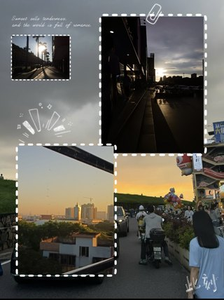 | 已交付 [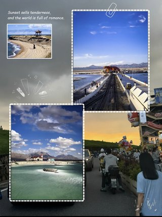](cases/002/qwen/final.png) | 已交付 [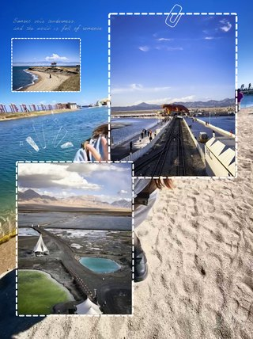](cases/002/luna/final.png) | 已交付 [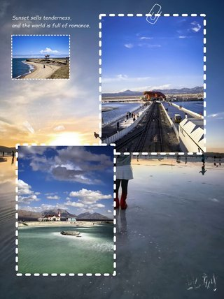](cases/002/sol/final.png) |
| [003 · 20260915-170355_封面样图.png](cases/003/README.md)  | 已交付  | 已交付 [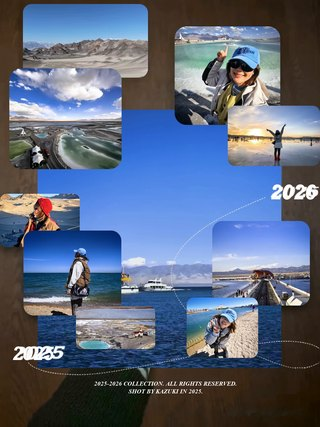](cases/003/luna/final.png) | 已交付  |
| [004 · 20260915-170441_封面样图.png](cases/004/README.md)  | 已交付  | 已交付 [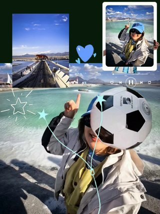](cases/004/luna/final.png) | 已交付  |
| [005 · 20260915-170446_封面样图.png](cases/005/README.md) 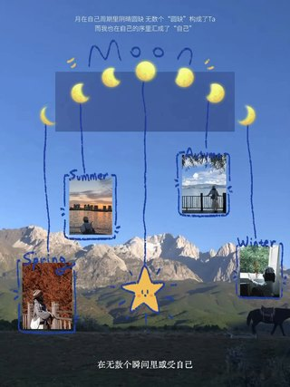 | 已交付  | 已交付  | 已交付 [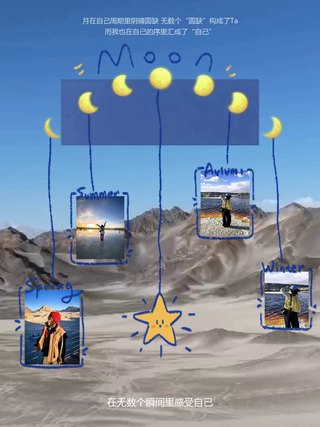](cases/005/sol/final.png) |
| [006 · 20260915-170457_封面样图.png](cases/006/README.md)  | 已交付  | 已交付  | 已交付  |
| [007 · 20260915-170502_封面样图.png](cases/007/README.md) 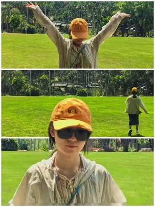 | 已交付  | 已交付  | 已交付 [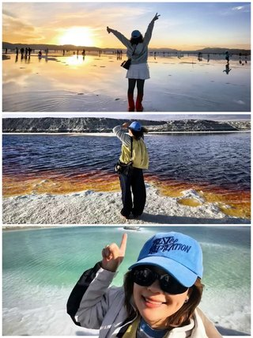](cases/007/sol/final.png) |
| [008 · 7472129870554893630.png](cases/008/README.md)  | 已交付  | 已交付  | 已交付  |
| [009 · 7475247081922252056.png](cases/009/README.md)  | 已交付  | 已交付 [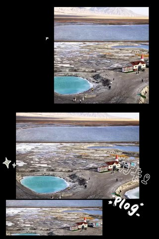](cases/009/luna/final.png) | 已交付 [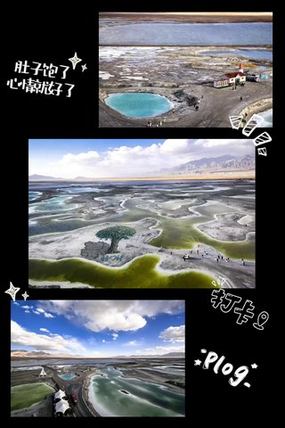](cases/009/sol/final.png) |
| [010 · 7475568224013208894.png](cases/010/README.md)  | 已交付  | 已交付  | 已交付  |
| [011 · 7476679583430053145.png](cases/011/README.md)  | 已交付  | 已交付  | 已交付 [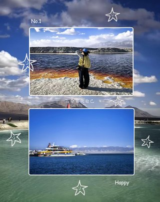](cases/011/sol/final.png) |
| [012 · 7490956089585077529.png](cases/012/README.md) 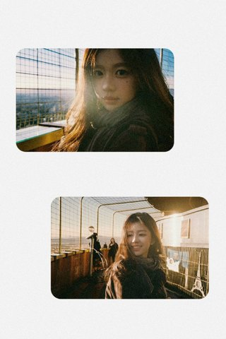 | 已交付  | 已交付  | 已交付  |
| [013 · 7492325253402692888.png](cases/013/README.md)  | 失败 | 已交付  | 已交付 [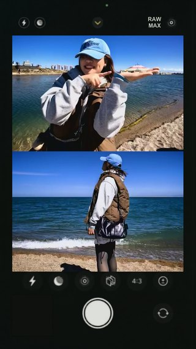](cases/013/sol/final.png) |
| [014 · 7496082541808766270.png](cases/014/README.md)  | 已交付 [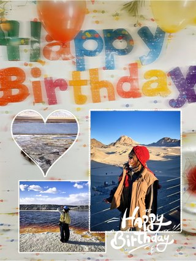](cases/014/qwen/final.png) | 已交付  | 已交付  |
| [015 · 7496141849216798014.png](cases/015/README.md) 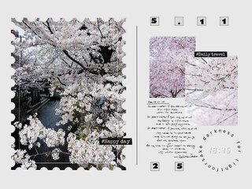 | 已交付 [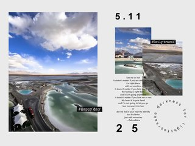](cases/015/qwen/final.png) | 已交付 [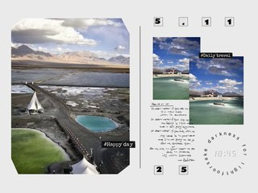](cases/015/luna/final.png) | 已交付 [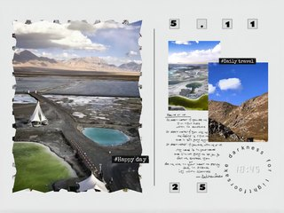](cases/015/sol/final.png) |
| [016 · 7496451573170752793.png](cases/016/README.md)  | 失败 | 已交付  | 已交付  |
| [017 · 7501925026891861272.png](cases/017/README.md)  | 已交付  | 已交付  | 已交付  |
| [018 · 7502022491997687064.png](cases/018/README.md)  | 已交付  | 已交付  | 已交付  |
| [019 · 7503210634738175294.png](cases/019/README.md)  | 已交付  | 已交付  | 已交付  |
| [020 · 7506104656221932825.png](cases/020/README.md)  | 已交付  | 已交付  | 已交付  |
| [021 · 7506123854322912536.png](cases/021/README.md)  | 已交付  | 已交付  | 已交付  |
| [022 · 7507115505459776792.png](cases/022/README.md) 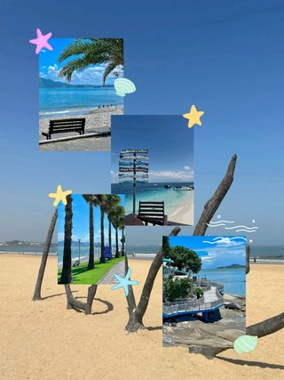 | 失败 | 已交付  | 已交付  |
| [023 · 7507559464296402238.png](cases/023/README.md)  | 已交付  | 已交付  | 已交付  |
| [024 · 7508318975013604633.png](cases/024/README.md)  | 已交付 [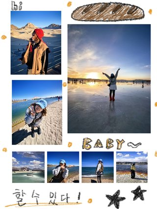](cases/024/qwen/final.png) | 已交付 [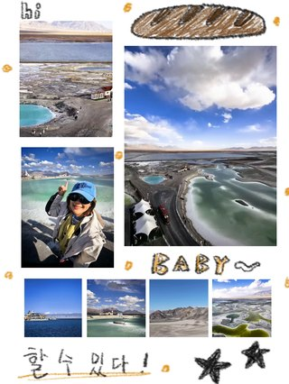](cases/024/luna/final.png) | 已交付 [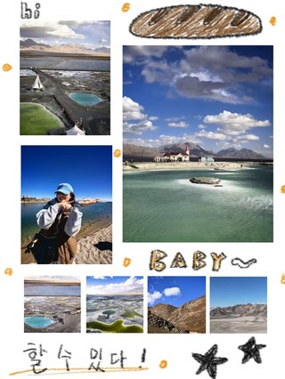](cases/024/sol/final.png) |
| [025 · 7515417784248143129.png](cases/025/README.md)  | 失败 | 已交付  | 已交付  |
| [026 · 7517211659681828120.png](cases/026/README.md)  | 已交付  | 已交付  | 已交付  |
| [027 · 7517266594482146584.png](cases/027/README.md)  | 已交付  | 已交付  | 已交付  |
| [028 · 7517301630241393982.png](cases/028/README.md)  | 已交付  | 已交付  | 已交付  |
| [029 · 7517959251277466904.png](cases/029/README.md)  | 失败 | 已交付 [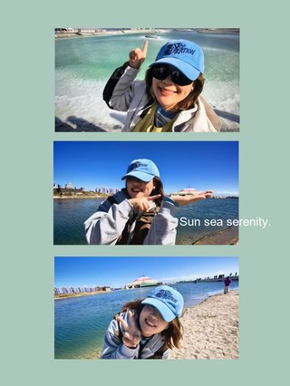](cases/029/luna/final.png) | 已交付  |
| [030 · 7518055452836449561.png](cases/030/README.md)  | 已交付  | 已交付  | 已交付  |
| [031 · 7519411309943803160.png](cases/031/README.md)  | 已交付 [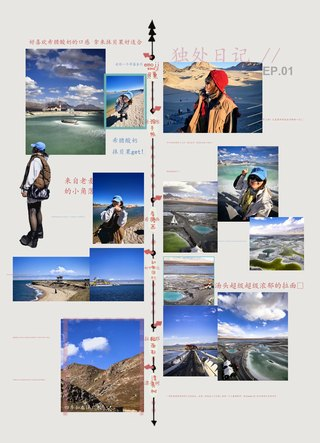](cases/031/qwen/final.png) | 已交付  | 已交付  |
| [032 · 7519493398391393598.png](cases/032/README.md)  | 已交付 [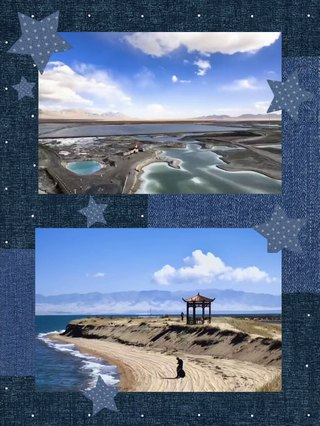](cases/032/qwen/final.png) | 已交付  | 已交付  |
| [033 · 7519497099734699289.png](cases/033/README.md) 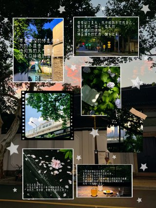 | 已交付  | 已交付  | 已交付  |
| [034 · 7519513126958681369.png](cases/034/README.md) 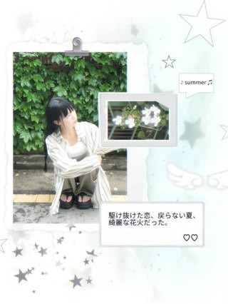 | 已交付 [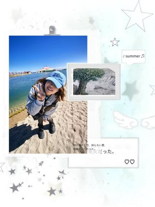](cases/034/qwen/final.png) | 已交付 [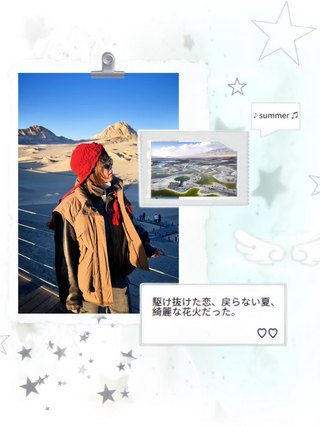](cases/034/luna/final.png) | 已交付  |
| [035 · 7522520809114438974.png](cases/035/README.md)  | 已交付 [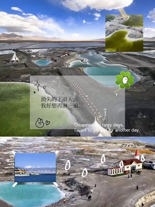](cases/035/qwen/final.png) | 已交付 [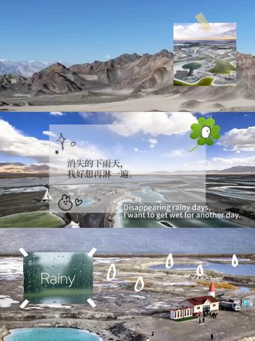](cases/035/luna/final.png) | 已交付 [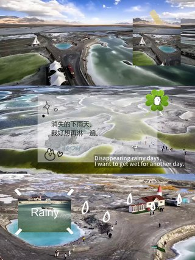](cases/035/sol/final.png) |
| [036 · 7523151787109403966.png](cases/036/README.md)  | 已交付  | 已交付 [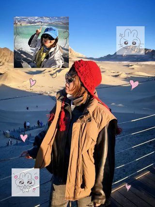](cases/036/luna/final.png) | 已交付  |
| [037 · 7523167569713302808.png](cases/037/README.md)  | 已交付  | 已交付  | 已交付  |
| [038 · 7523761490264968473.png](cases/038/README.md)  | 已交付 [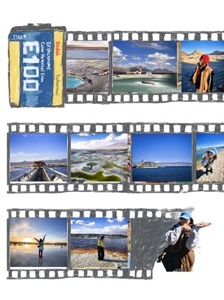](cases/038/qwen/final.png) | 已交付 [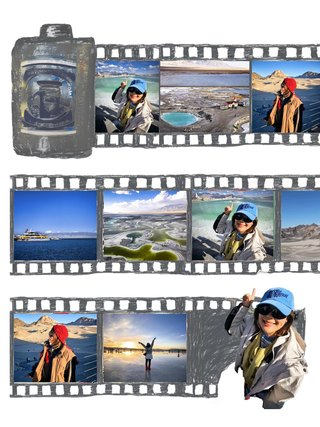](cases/038/luna/final.png) | 已交付  |
| [039 · 7524708586056944920.png](cases/039/README.md) 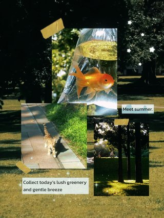 | 已交付  | 已交付  | 已交付  |
| [040 · 7524766994856545560.png](cases/040/README.md) 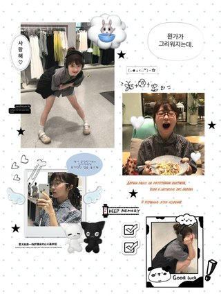 | 已交付  | 已交付 [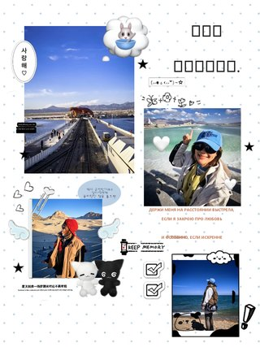](cases/040/luna/final.png) | 已交付  |
| [041 · 7525873861783457048.png](cases/041/README.md)  | 失败 | 已交付  | 已交付  |
| [042 · 7525889741448006936.png](cases/042/README.md)  | 已交付  | 已交付  | 已交付  |
| [043 · 7527688123527040280.png](cases/043/README.md) 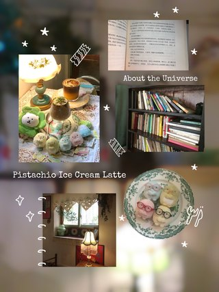 | 已交付  | 已交付 [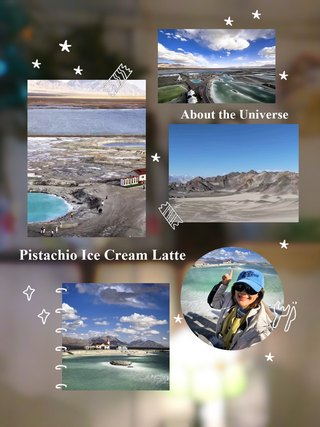](cases/043/luna/final.png) | 已交付 [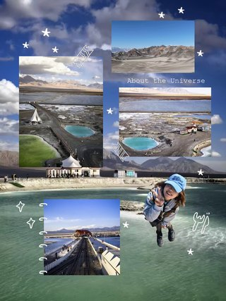](cases/043/sol/final.png) |
| [044 · 7527721918284434712.png](cases/044/README.md) 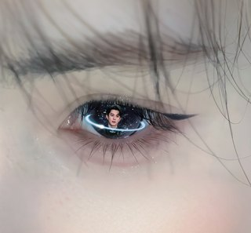 | 已交付  | 已交付  | 已交付  |
| [045 · 7529796919867034942.png](cases/045/README.md)  | 失败 | 已交付  | 已交付  |
| [046 · 7530229131825630488.png](cases/046/README.md) 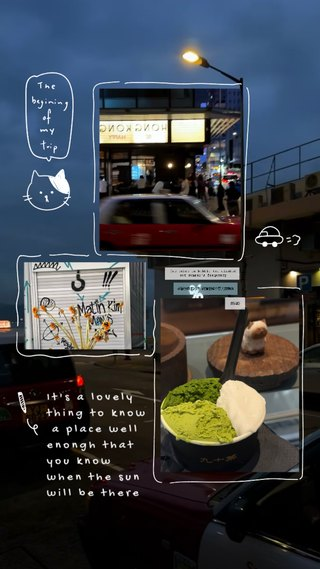 | 失败 | 已交付 [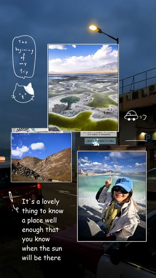](cases/046/luna/final.png) | 已交付 [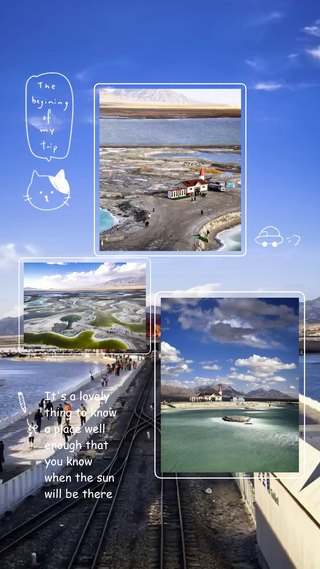](cases/046/sol/final.png) |
| [047 · 7530625140900580632.png](cases/047/README.md)  | 已交付  | 已交付  | 已交付  |
| [048 · 7530663650252639512.png](cases/048/README.md) 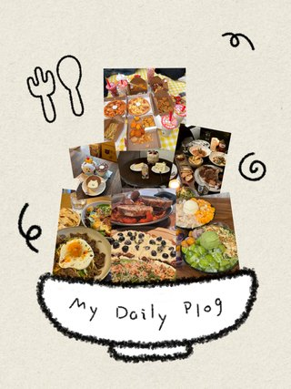 | 已交付  | 已交付  | 已交付 [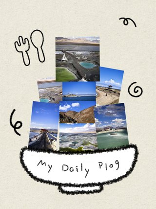](cases/048/sol/final.png) |
| [049 · 7531007146255928638.png](cases/049/README.md)  | 已交付  | 已交付  | 已交付  |
| [050 · 7532822320377941310.png](cases/050/README.md)  | 已交付  | 已交付  | 已交付  |
| [051 · 7534386598872370457.png](cases/051/README.md)  | 已交付  | 已交付  | 已交付  |
| [052 · 7535801952681332030.png](cases/052/README.md) 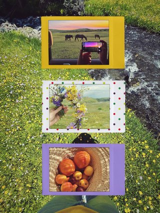 | 已交付  | 已交付  | 已交付  |
| [053 · 7535811511269395736.png](cases/053/README.md)  | 失败 | 已交付  | 已交付  |
| [054 · 7536187688081280318.png](cases/054/README.md)  | 已交付  | 已交付  | 已交付  |
| [055 · 7537221833469316414.png](cases/055/README.md)  | 已交付  | 已交付  | 已交付  |
| [056 · 7538408003763031320.png](cases/056/README.md)  | 已交付  | 已交付  | 已交付  |
| [057 · 7538422147958639897.png](cases/057/README.md)  | 已交付  | 已交付  | 已交付  |
| [058 · 7538583629111364926.png](cases/058/README.md)  | 已交付  | 已交付  | 已交付  |
| [059 · 7538634074844335422.png](cases/059/README.md)  | 已交付  | 已交付  | 已交付  |
| [060 · 7538947099040206142.png](cases/060/README.md)  | 已交付  | 已交付  | 已交付  |
| [061 · 7539931779700919576.png](cases/061/README.md)  | 已交付  | 已交付  | 已交付  |
| [062 · 7539951064926358808.png](cases/062/README.md)  | 已交付  | 已交付  | 已交付  |
| [063 · 7541432873266695448.png](cases/063/README.md)  | 已交付  | 已交付  | 已交付  |
| [064 · 7543564599996452120.png](cases/064/README.md)  | 已交付  | 已交付  | 已交付  |
| [065 · 7545411368267042072.png](cases/065/README.md)  | 已交付  | 已交付  | 已交付  |
| [066 · 7548076039906282777.png](cases/066/README.md)  | 已交付  | 已交付  | 已交付  |
| [067 · 7548808621631540504.png](cases/067/README.md)  | 已交付  | 已交付  | 已交付  |
| [068 · 7550206233802886462.png](cases/068/README.md)  | 已交付  | 已交付  | 已交付  |
| [069 · 7551019784301727038.png](cases/069/README.md)  | 已交付  | 已交付  | 已交付  |
| [070 · 7552163107628469566.png](cases/070/README.md)  | 已交付  | 已交付  | 已交付  |
| [071 · 7552166112163663128.png](cases/071/README.md)  | 已交付  | 已交付  | 已交付  |
| [072 · 7553883595644095768.png](cases/072/README.md)  | 已交付  | 已交付  | 已交付  |
| [073 · 7555515776971902270.png](cases/073/README.md)  | 已交付  | 已交付  | 已交付  |
| [074 · 7555582639198096664.png](cases/074/README.md)  | 已交付  | 已交付  | 已交付  |
| [075 · 7555590846674963736.png](cases/075/README.md)  | 已交付  | 已交付  | 已交付  |
| [076 · 7555722765878201624.png](cases/076/README.md)  | 已交付  | 已交付  | 已交付  |
| [077 · 7556258375718325528.png](cases/077/README.md)  | 已交付  | 已交付  | 已交付  |
| [078 · 7556443131093355838.png](cases/078/README.md)  | 已交付  | 已交付  | 已交付  |
| [079 · 7558079090742496537.png](cases/079/README.md)  | 已交付  | 已交付  | 运行中 · photo_windows |
| [080 · 7560336628808650008.png](cases/080/README.md)  | 已交付  | 已交付  | 排队 |
| [081 · 7562518032552119576.png](cases/081/README.md)  | 已交付  | 已交付  | 排队 |
| [082 · 7566531799308848446.png](cases/082/README.md)  | 已交付  | 已交付  | 待提交 |
| [083 · 7566535410222992702.png](cases/083/README.md)  | 失败 | 已交付  | 待提交 |
| [084 · 7571786786058489150.png](cases/084/README.md)  | 失败 | 已交付  | 待提交 |
| [085 · 7572099957507788094.png](cases/085/README.md)  | 已交付  | 已交付  | 待提交 |
| [086 · 7572103044003974424.png](cases/086/README.md)  | 已交付  | 已交付  | 待提交 |
| [087 · 7612274506635169086.jpg](cases/087/README.md)  | 已交付  | 已交付  | 待提交 |
| [088 · 7663561226697329944.png](cases/088/README.md)  | 已交付  | 已交付  | 待提交 |
| [089 · 7664149953434111256.jpg](cases/089/README.md)  | 失败 | 已交付  | 待提交 |
| [090 · 7664468308615384344.jpg](cases/090/README.md)  | 已交付  | 已交付  | 待提交 |
| [091 · 7665644059188399384.jpg](cases/091/README.md)  | 已交付  | 已交付  | 待提交 |
| [092 · 7665948685888539966.png](cases/092/README.md)  | 已交付  | 已交付  | 待提交 |
| [093 · 7666084872900873497.png](cases/093/README.md)  | 已交付  | 已交付  | 待提交 |
| [094 · 7668519416618847513.jpg](cases/094/README.md)  | 已交付  | 已交付  | 待提交 |
| [095 · 7669705159856885017.jpg](cases/095/README.md)  | 已交付  | 已交付  | 待提交 |
| [096 · 7670227343935507774.jpg](cases/096/README.md)  | 已交付  | 已交付  | 待提交 |
| [097 · 7670715950710197566.jpg](cases/097/README.md)  | 已交付  | 已交付  | 待提交 |
| [098 · 7671186619956874521.jpg](cases/098/README.md)  | 已交付  | 已交付  | 待提交 |
| [099 · 7672090678213692734.jpg](cases/099/README.md)  | 已交付  | 已交付  | 待提交 |
| [100 · 7673213423974485273.png](cases/100/README.md)  | 已交付  | 已交付  | 待提交 |
| [101 · 7673624513279462666.jpg](cases/101/README.md)  | 已交付  | 已交付  | 待提交 |
| [102 · 7673831835054509337.png](cases/102/README.md)  | 失败 | 已交付  | 待提交 |
| [103 · 7678227195931807001.png](cases/103/README.md)  | 失败 | 已交付  | 待提交 |
| [104 · 7680436475229605145.png](cases/104/README.md)  | 已交付  | 已交付  | 待提交 |
| [105 · 7686374056987430169.png](cases/105/README.md)  | 已交付  | 已交付  | 待提交 |
| [106 · 7693726942612180286.jpg](cases/106/README.md)  | 失败 | 已交付  | 待提交 |
| [107 · 7694897637488626969.png](cases/107/README.md)  | 已交付  | 已交付  | 待提交 |
| [108 · reference-a.png](cases/108/README.md)  | 已交付  | 已交付  | 待提交 |
| [109 · 拼贴1.jpg](cases/109/README.md)  | 失败 | 已交付  | 待提交 |
| [110 · 拼贴2.jpg](cases/110/README.md)  | 已交付  | 已交付  | 待提交 |
| [111 · 拼贴3.jpg](cases/111/README.md)  | 已交付  | 已交付  | 待提交 |
| [112 · 拼贴4.jpg](cases/112/README.md)  | 已交付  | 已交付  | 待提交 |
| [113 · 拼贴5.jpg](cases/113/README.md)  | 已交付  | 已交付  | 待提交 |
| [114 · 拼贴6.jpg](cases/114/README.md)  | 已交付  | 已交付  | 待提交 |
| [115 · 拼贴7.jpg](cases/115/README.md)  | 已交付  | 已交付  | 待提交 |
| [116 · 海边人像拼图.jpg](cases/116/README.md)  | 已交付  | 已交付  | 待提交 |

原尺寸成图和关键中间产物逐项同步。原始客户视频、凭证、请求图片载荷不进入报告。

本机工作台：http://127.0.0.1:18809/ 。完整运行产物位于相邻输出目录的 `model-comparison-20261023/runtime/`。
后台进程每 60 秒检查进度并尝试 Git 推送；网络失败会保留本地提交并继续重试。
恢复运行：在工程目录用已有 Python 环境执行 `python -B reports/model-comparison-20261023/run_campaign.py`。
