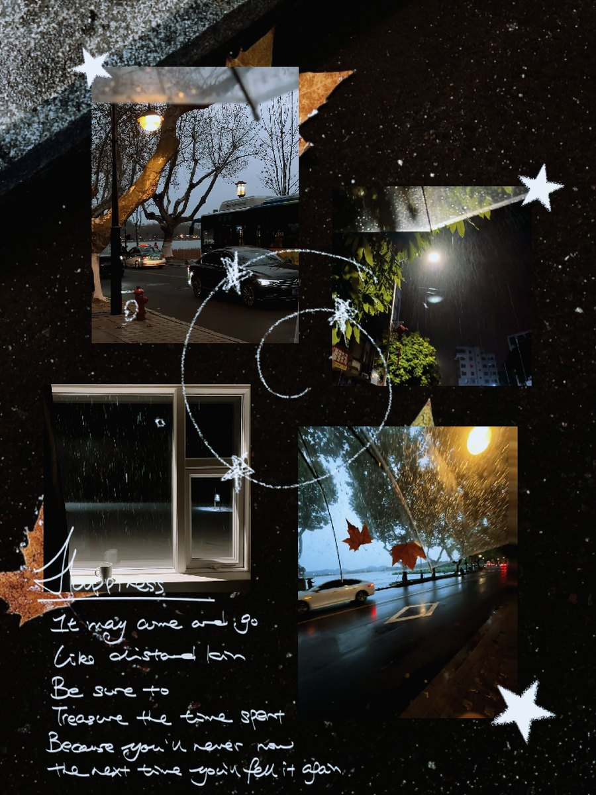
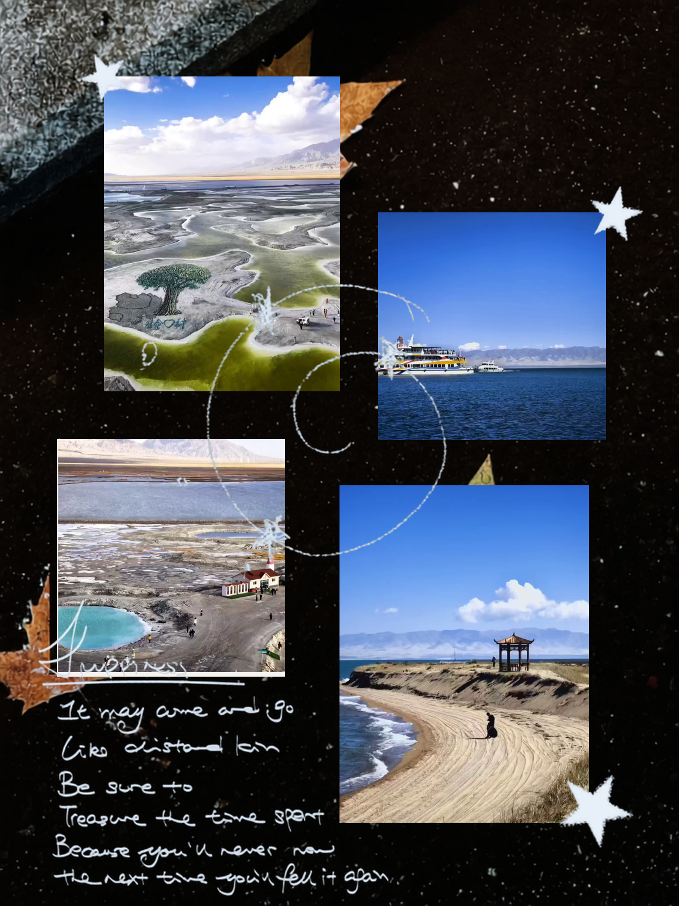

# 084 · 7571786786058489150.png

[返回总览](../../README.md)



## yibuapi Qwen3.8-flash / thinking off

失败

耗时：556.1 秒；交付类别：None。

失败信息：

```text
yibu / qwen3.8-flash HTTP 502：上游网关错误
```

[查看参数、中间 JSON、告警及对照图](qwen/)

## Codex gpt-6-luna / medium

已交付

耗时：235.8 秒；交付类别：with_issues。



[查看参数、中间 JSON、告警及对照图](luna/)

## Codex gpt-6.1-sol / medium

待提交
